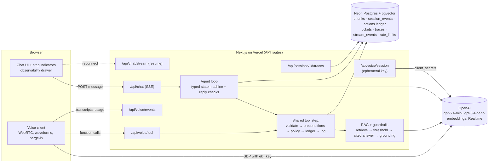
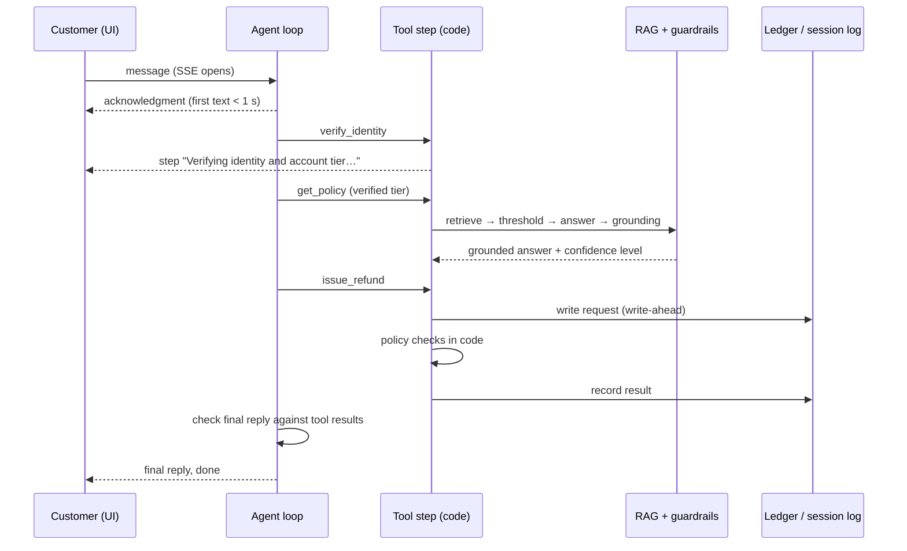
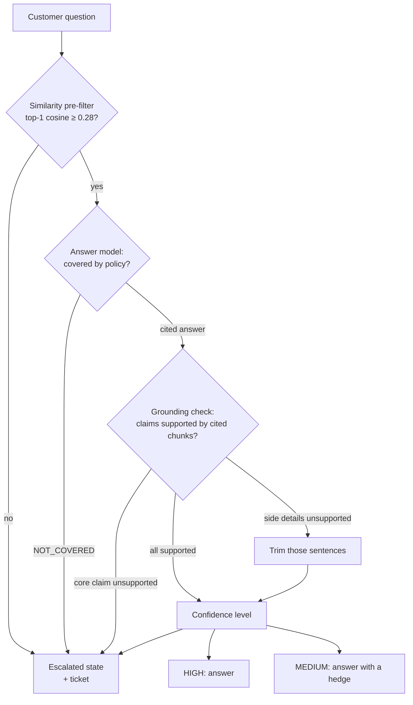
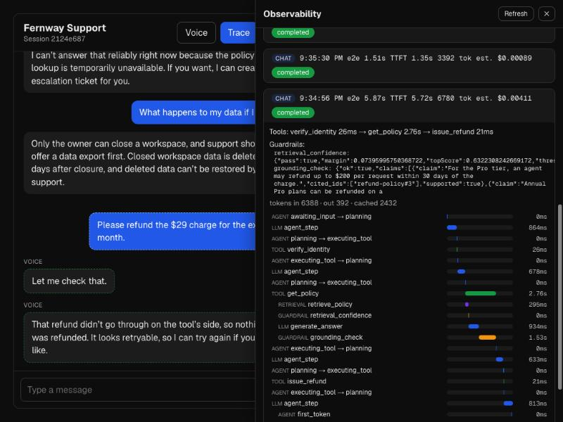
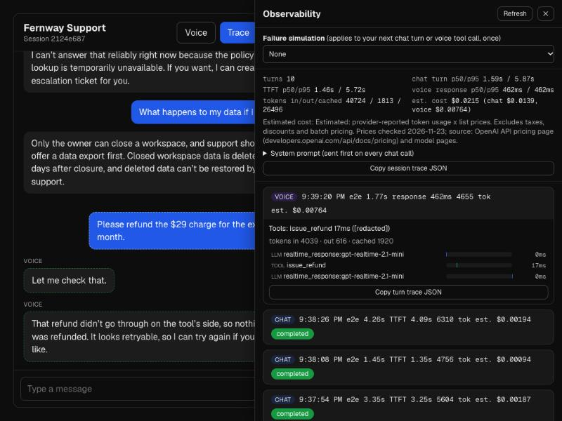

# Fernway Support: customer support AI agent (chat + live voice)

A full-stack support agent for a fictional SaaS, **Fernway Workspace**. It answers from a policy knowledge base behind measured guardrails, verifies customers, issues refunds within policy, and escalates to humans, over **streaming chat** and **live voice** that share one session.

> **Core idea: the model proposes, code decides.** The model chooses tools and writes replies; refund limits, identity checks and escalation rules are enforced in code, and replies are checked against what the tools actually returned.

| | |
|---|---|
| **Live demo** | https://customer-support-agent-sable-two.vercel.app (voice debugging: `/voice-debug`) |
| **Demo account** | `omar@example.com`, PIN `715204` (Pro tier). All demo accounts are listed on the page; they are fictional, and PINs are shown on purpose. Demo data resets daily |
| **Loom walkthrough** | _link added after recording_ |
| **Stack** | Next.js (App Router, TypeScript) on Vercel · Neon Postgres + pgvector · OpenAI (`gpt-5.4-mini` agent, `gpt-5.4-nano` checks, embeddings, Realtime voice) |
| **Tests** | 214 tests (unit, scripted-model scenarios, architecture), CI on every push |

**Evidence and its limits: [docs/EVIDENCE.md](docs/EVIDENCE.md)** (intervals, harder set, confidence validation, labelling, what breaks at 100× traffic) · design decisions: [docs/DECISIONS.md](docs/DECISIONS.md) · review findings: [docs/REVIEW.md](docs/REVIEW.md)

## How this meets the brief

| Brief requirement | What's built | Where to see it |
|---|---|---|
| **Streaming chat** with step status | SSE with typed, numbered events; live steps such as "Verifying identity and account tier…", "Searching knowledge base…"; first text in under a second | Chat UI · `app/api/chat` |
| **Live voice** with waveform, transcripts, interruption | OpenAI Realtime over WebRTC; waveforms for both sides; live transcripts; barge-in that stops playback and truncates to what was heard; listening / thinking / speaking indicator | Voice toggle · `components/voice` |
| **Observability drawer** | Per-turn span tree, redacted prompts, latency (time to first token, end-to-end, per tool, p50/p95), tokens, **estimated** cost (voice included) | Drawer · `lib/observability` |
| **Vector retrieval + custom chunking** | pgvector on Neon; section-aware chunking with tier metadata; tier filter in SQL | [Chunking choices](#chunking-choices) |
| **Confidence guardrails → human escalation** | Similarity pre-filter, an abstaining answer model, a grounding check, and a 3-level confidence score; low confidence ends the turn in an `escalated` state with a ticket | [Guardrails and confidence](#guardrails-and-confidence) |
| **Reasoning loop with ≥3 chained tools** | Typed state machine; `verify_identity` → `get_policy` (tier-filtered) → `issue_refund` / `create_escalation_ticket` | [Tools and policy](#tools-and-policy-enforced-in-code) |
| **Live tool status in the UI** | `step_started` / `step_completed` events in chat; the same steps, plus a spoken "Let me check that…", in voice | Chat and voice UIs |
| **Error recovery** | Retries with backoff, typed fallbacks per failure, a 40 s turn deadline, stream resume, and a failure-simulation control | [Resilience](#resilience-observability-and-security) |
| **Session state across text and voice** | One append-only session log shared by both modes: verify in chat, continue by voice, or the reverse | `lib/session` |
| **Deliverables** | Repo with `.env.example` · this README · live demo · Loom | above |

## Architecture



- **One tool step and one session log for chat and voice:** voice function calls go to `/api/voice/tool`, which runs the *same* validation, policy and ledger code as chat. Keys stay on the server (the browser gets a 60-second ephemeral voice key).
- **Layers are enforced** by `tests/architecture.test.ts` and an ESLint rule: UI → API routes → `lib/server` → `agent`/`voice` → `tools` → `guardrails` → `rag` → infra.

### How one chat turn works



At most 6 tool steps per turn (then a final reply is forced). Every turn has a **40 s deadline** passed to every OpenAI call (8 s per call inside tools; our retry layer is the only one).

## Chunking choices

- **Corpus:** 11 support documents in `data/policies/` (tiers, refunds, contract status, account changes, billing disputes, three troubleshooting guides, escalation, privacy, one deliberately poisoned FAQ).
- **Section-aware chunks** (`lib/rag/chunker.ts`): one chunk per `##`/`###` section so a tier's limit, window and conditions stay together; 350-token cap with 40-token overlap only when a section must be split; each chunk's embedded text is prefixed with `title > section`.
- **Tier metadata** from front matter, narrowed per section; the tier filter runs **in SQL** (pgvector HNSW, iterative scan). Result: 52 chunks, median 66 tokens.
- **Rejected:** fixed-size windows (they split a rule from its conditions and mix tiers).
- **Prompt injection:** instruction-like text is quarantined at ingest; documents are framed as data; policy is enforced in tool code.

## Guardrails and confidence



- **Similarity pre-filter (0.28):** a cheap screen before any LLM call, **not a calibrated boundary** (results are flat from 0.10 to 0.44 on the calibration split).
- **Answer model abstaining (`NOT_COVERED`):** caught **all 8 blind near-misses**.
- **Grounding check:** cited claims checked by `gpt-5.4-nano`; unsupported side details are trimmed. Its value on real drafts isn't measured separately yet.
- **Confidence shown as HIGH / MEDIUM / LOW**, not raw similarity (raw scores stay in the drawer). LOW ends the turn `escalated`: a P3 ticket for verified customers, an offer for unverified ones. Unverified questions about the customer's own plan ask them to verify instead.

**Blind results** (v1 held-out 10 + v2 30; latest runs; exact 95% Clopper–Pearson intervals):

| Items | False escalations | Missed escalations |
|---|---|---|
| All 40 | 1/20 (5%, CI 0–25%) | **0/20** (0%, CI 0–17%) |
| Hard: near-miss, tier-specific, approval demands, injections (23) | 1/11 (9%, CI 0–41%) | 0/12 (0%, CI 0–26%) |
| Ordinary in-scope (9) | 0/9 (0%, CI 0–34%) | — |
| Out-of-domain (8) | — | 0/8 (0%, CI 0–37%) |

False escalations vary between runs (v2: 1–2 of 15 over four runs); missed escalations were 0 in every run. The harder set (18 items written before running) misses **3–5 of 9** escalations, mostly approval demands. HIGH vs MEDIUM accuracy isn't separated at these sample sizes. Labels are by AI, not humans. Details, run history and caveats: **[docs/EVIDENCE.md](docs/EVIDENCE.md)**.

## Tools and policy (enforced in code)

| Tool | Rules |
|---|---|
| `verify_identity(email, PIN)` | Same error whether or not the email exists · locks after 3 failures in a conversation (P1 security ticket) · 5 per account + IP per 15 min, 20 per account per hour · returns only tier, contract status and invoices |
| `get_policy(question)` | The guarded RAG pipeline, filtered to the **verified** customer's tier (general sections only before verification) |
| `issue_refund(invoice, amount, reason)` | Identity → the customer asked for a refund (chat) **for this invoice** (else `INVOICE_MISMATCH`; none named and several eligible → `INVOICE_AMBIGUOUS`, the agent asks) → contract active (expired/suspended opens the billing ticket in code) → own invoice → no chargeback → not already refunded → whole cents, ≤ invoice → within window → within tier limit (Free $20/7 d · Pro $200/30 d · Enterprise $1,000/60 d), on the **current** account record. Write-ahead idempotent ledger; one active refund per invoice (unique index); a crashed pending entry expires after 2 minutes |
| `create_escalation_ticket(reason, summary)` | Priority from the escalation policy · response target from the tier · idempotent per session and topic |

**Checks on what the customer reads:**
- **Final-reply grounding** against this conversation's tool results. No tool ran and a claim is unsupported → code runs the guardrail itself, so "recommend a stock" escalates whatever the model chose. Unsupported sentences after a policy lookup are removed. Action-tool turns and short confirmations are only logged.
- **Action-claim check:** a claimed refund, ticket or amount the tools didn't produce is replaced with what happened (20/20 on a labelled set).
- **In voice,** spoken audio can't be rewritten, so these checks flag the mismatch instead.

## Resilience, observability and security

- **Failures:** retries with backoff and jitter (honouring `Retry-After`, never after text streamed); a typed UI state per failure; stream resume from the last event number; a **failure-simulation control** in the drawer that injects real faults (`evals/RESILIENCE_CHECKS.md`).
- **Observability drawer:** span tree with start/end times and error spans; redacted prompts and tool I/O; guardrail decisions; time to first token, end-to-end, per tool, p50/p95; tokens and **estimated** cost (voice included).
- **Security and cost:** sessions bound to the creating browser (HttpOnly cookie); per-IP and daily rate limits (Postgres); PINs redacted before storage; ephemeral voice keys; CSP and security headers; `/api/health` checks DB, embeddings and LLM without spending tokens.

| 3-tool chat turn | Voice turn and session summary |
|---|---|
|  |  |

## Key trade-offs

| Choice | Why | Cost |
|---|---|---|
| One Next.js app on Vercel; Neon Postgres + pgvector for everything | One deploy, shared types; tier filter and joins in SQL | No long-lived server (chat uses SSE); not a dedicated vector DB |
| Custom typed state machine, not LangGraph | Every state and transition explicit and tested | Less built-in tooling |
| `gpt-5.4-mini` agent, `gpt-5.4-nano` checks | Mini passed the scenarios (nano took unrequested actions); nano is enough for extraction and checks | ~$0.002–0.005 per chat turn |
| `gpt-realtime-2.1-mini` for voice, semantic turn detection | About 3× cheaper audio; waits for callers to finish (e.g. reading a PIN) | Interruption detected ~0.5–0.8 s after the caller starts |
| Held, checked final replies | False action claims corrected before release; ungrounded facts caught in no-tool and policy turns | The final reply arrives as a block (~1–2 s); a claim-free acknowledgment keeps first text under 1 s |
| Browser-enforced 3-minute voice cap | The browser connects to OpenAI directly, so the server can't hang up | Backed by 60 s keys, per-IP/daily caps and output-token limits |
| Sessions bound to a browser cookie, no accounts | Nobody can read or act on another session | Clearing cookies loses old conversations |

## Known limitations

- **Voice limits aren't server-enforced** (cap, session settings, usage reporting); held server-side: 60 s keys, 6 voice sessions per IP per 10 min and 150 per day, output-token caps, every tool call through `/api/voice/tool` (DECISIONS D55).
- **Voice was tested with synthetic speech** played into the microphone track; the network drop was simulated.
- **"Ask which invoice" is chat-only;** voice checks invoice mismatches against transcripts logged so far.
- **Heard text after an interruption is estimated** (~15 characters per second) when the server doesn't confirm truncation.
- **Shared demo data** (no user accounts); it resets daily.
- **Small, AI-labelled evaluation sets:** see [docs/EVIDENCE.md](docs/EVIDENCE.md) for what they do and don't show.

## Run it

```bash
cp .env.example .env.local        # DATABASE_URL (Neon, pooled), OPENAI_API_KEY; optional ADMIN_KEY, CRON_SECRET
npm install
npm run db:migrate                # applies db/migrations/*.sql once each
npm run ingest                    # chunk + embed data/policies (idempotent)
npm run dev                       # http://localhost:3000
```

| Command | What it does |
|---|---|
| `npm test` · `npm run typecheck` · `npm run lint` | Unit, scenario and architecture tests; type and lint checks |
| `npm run eval:guardrails` · `eval:heldout` · `eval:grounding` | Threshold sweep, held-out sets, grounding-checker sanity set → `evals/RESULTS.md` |
| `npm run eval:agent -- gpt-5.4-mini [--repeat 5]` | Live multi-turn scenarios → `evals/AGENT_RESULTS.md` |
| `npm run eval:action-claims` · `eval:confidence [-- --set v3]` · `eval:evidence` | Action-claim check, confidence validation / harder set, evidence summary with intervals |
| `npm run demo:reset` | Clears demo refunds and tickets (also runs daily via a protected Vercel cron) |
| `GET /api/rag/search?q=…` | Retrieval inspector: public = general sections, no traces; with `x-admin-key`, tier filter and full trace |
