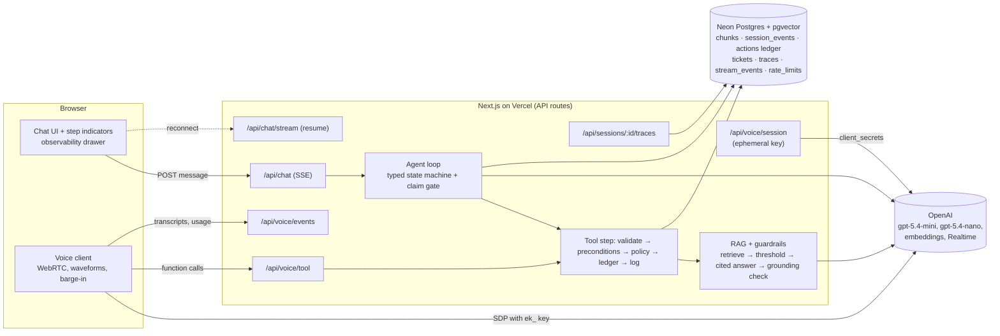

# Fernway Support: customer support AI agent (chat + live voice)

A full-stack customer support agent for a fictional SaaS ("Fernway Workspace"). It answers from a policy knowledge base behind measured guardrails (a similarity pre-filter, an abstaining answer model, a grounding check and a 3-level confidence score), verifies customers, issues refunds within policy, and escalates to humans. It works over streaming chat and live voice, shares one session across both, and shows every step in an observability drawer.

- **Live demo:** https://customer-support-agent-sable-two.vercel.app (voice debugging and test clips: `/voice-debug`)
- **Demo accounts:** listed on the page (fictional; PINs shown on purpose). Example: `omar@example.com`, PIN `715204`, Pro tier.
- **Loom walkthrough:** _link added after recording_

## Architecture



**Module map**

| Module | Responsibility |
|---|---|
| `lib/contracts.ts` | Client-safe shared contracts: tool names/labels, `ToolOutcome` (discriminated union per tool), API payloads (voice session/tool, transcript lines, trace report) |
| `lib/server` | Production wiring (Postgres stores, OpenAI clients) and transcript building for the routes |
| `lib/agent` | Turn loop (`run.ts`), typed state machine (`machine.ts`), model port + OpenAI adapter, retries (`retry.ts`), system prompt |
| `lib/tools` | Tool registry (zod schemas, preconditions, typed errors, typed handler map), **policy as pure code** (`policy.ts`), tools, the shared tool step for chat and voice (`step.ts`), stores behind ports (Postgres + in-memory), mock CRM |
| `lib/rag` | Section-aware chunker, idempotent ingest, embeddings, tier-filtered pgvector retrieval, data-only prompt framing, injection scanner, cited answer generation |
| `lib/guardrails` | Retrieval-confidence gate, citation check, LLM claim check, the guarded pipeline (dependencies injectable for tests), the agent's sentence claim gate (`claims.ts`) |
| `lib/voice` | Realtime session config + ephemeral key minting, voice tool bridge, transcript and usage recording |
| `lib/session` | Append-only session event log (shared by chat and voice), stream log for resume, per-browser session ownership |
| `lib/observability` | Traces (spans with parents, tokens, cost), redaction, persistence, the drawer report (p50/p95) |
| `app/`, `components/` | Next.js pages and API routes; chat, SSE client (`sse.ts`), voice (`components/voice`: `useVoice` lifecycle hook + `transport`, `audio`, `realtimeEvents`, `toolBridge`, `interruption`, `transcript`), waveforms, trace drawer |

**Layers** (enforced by `tests/architecture.test.ts` and an ESLint rule for `components/**`): UI → API routes → `lib/server` → orchestration (`agent`, `voice`) → `tools` → `guardrails` → `rag` → infra (`db`, `session`, `observability`). Imports only go downward; `lib/contracts`, `lib/types`, `lib/config` and `data/` are shared.

## How a turn works

**Chat** (`POST /api/chat` → SSE). The agent rebuilds context from the session log. The model (`gpt-5.4-mini`, one tool call per step, at most 6 steps) chooses a tool, and **code** runs it:
1. Validate the input with zod.
2. Check preconditions (identity before any account action).
3. Apply the policy rules.
4. Write the action to the ledger.
5. Log the call and its result.

Each step streams `step_started` / `step_completed` events ("Verifying identity and account tier…", "Searching knowledge base…"). A tool turn with no model preamble first streams a short, claim-free acknowledgment, so first text arrives in under a second.

**What reaches the customer is checked in three layers:**
1. **Regex claim gate, per sentence.** Canonical false action claims are replaced at once.
2. **Final-reply grounding** (`lib/guardrails/final-reply.ts`). The final reply is held. `gpt-5.4-nano` lists its factual claims, and each must be stated by a record our tools returned in this conversation (grounded policy answers, receipts, refusals, tickets, the account view).
   - **No tool this turn and an unsupported claim** (off-topic, invented facts): code runs the guardrail itself, `get_policy` on the customer's own message. So "recommend a stock" reaches the escalated state with a ticket whatever the model chose to do.
   - **After a policy lookup:** unsupported sentences are removed. If the lookup escalated, the deterministic handoff with the ticket number is used.
   - **Turns with only action tools:** a finding is logged, not acted on, because the checker flags harmless paraphrases of tool results.
3. **Model action-claim check**, only on text with a completion verb, amount or ticket id. 2 s cap, no retries; on timeout the regex result stands and the trace flags it. False claims are replaced with the truth from the tool log (20/20 on a labelled set, `evals/ACTION_CLAIMS.md`).

In voice, audio already spoken can't be rewritten, so these checks flag instead. Every chat turn has one **40 s deadline**: its AbortSignal reaches every OpenAI call (8 s per call inside tools, no SDK retries; our retry layer is the only one). On deadline the customer gets a fallback reply and a `done` event. Events are numbered; a dropped stream resumes from the last number.

**Voice** (OpenAI Realtime over WebRTC). The server mints a 60-second ephemeral key with the instructions, tools and verified-account context; the browser connects directly.
- **Tool calls** go to `/api/voice/tool`, which runs the **same tool step as chat**.
- **Barge-in:** semantic VAD detects speech. The client mutes playback at once, clears the server audio buffer and truncates the item to what was heard. The transcript is marked "interrupted".
- **Shared session:** voice transcripts land in the same session log, so you can verify in chat and continue by voice, or the other way round.

## RAG and chunking

- **Corpus:** 11 support documents in `data/policies/`: tiers, refunds, contract status, account changes, billing disputes, three troubleshooting guides, escalation, privacy, and one deliberately poisoned FAQ.
- **Section-aware chunking** (`lib/rag/chunker.ts`):
  - One chunk per `##`/`###` section, so a tier's limit, window and conditions stay together.
  - 350-token cap with 40-token overlap, used only when a section is split.
  - Each chunk is labelled with its heading path. The embedded text is prefixed with `title > section`, so short sections keep their topic.
  - Tier scope comes from the front matter, narrowed per section by `<!-- tiers: pro, enterprise -->`. The tier filter runs **in SQL** (pgvector HNSW with iterative scan).
  - Result: 52 chunks, median 66 tokens. Fixed-size windows were rejected because they split a rule from its conditions and mix tiers in one chunk.
- **Ingest** is idempotent (a per-document hash of content, chunking settings, embedding model and injection detector). Instruction-like text is **quarantined at ingest**: stored, but excluded from retrieval. It is one layer among several; the others are data-only prompt framing, a claim checker that rejects instruction-based claims, and policy in tool code.

## Guardrails and confidence (what each part actually does)

Numbers below are from the current code, 2026-11-24, with exact 95% Clopper–Pearson intervals (`evals/RESULTS.md` "Evidence summary"; `npm run eval:evidence` recomputes them). Labels follow one rule (`evals/LABELING.md`): a query that only demands an approval ("approve my $900 refund") should escalate.

1. **Similarity pre-filter:** escalate if top-1 cosine < **0.28**, before any LLM call.
   - This is a cheap filter, **not a calibrated boundary**. On the calibration split the full guardrail's results are flat from 0.10 to 0.44: the same false and missed escalations at every threshold. 0.28 is the midpoint of that flat range, chosen from the score distributions.
   - What it does: screens clearly out-of-domain questions (8 of the 20 blind should-escalate items).
2. **Answer model abstains (NOT_COVERED):** the answer prompt allows "not covered".
   - On blind data, **all 8 near-miss questions were caught here**, not by the threshold or the grounding gate.
   - Across all 20 blind should-escalate items: abstention 11, pre-filter 8, grounding gate 1.
3. **Grounding gate:** citations must exist and be in the retrieved set. Then `gpt-5.4-nano` checks each claim against the cited chunks.
   - Its sanity set (9/9) used hand-written drafts. **Its value on real drafts isn't measured separately yet**: on blind data it caught 1 escalation.
   - **Partial grounding:** unsupported side details are removed instead of escalating the whole answer.
4. **Confidence level shown to customers: HIGH / MEDIUM / LOW**, not raw cosine. Raw scores stay in the trace drawer.
   - **HIGH:** grounded, nothing trimmed, top-1 ≥ 0.45 and the best document beats the second-best document by ≥ 0.10. Thresholds chosen on the calibration split only: every should-escalate item there had a doc margin ≤ 0.094.
   - **MEDIUM:** grounded but weaker or ambiguous retrieval, or partly grounded. Answered with a hedge.
   - **LOW:** escalated: verified customers get a P3 ticket in code, unverified ones are offered one, and the turn ends `escalated`.

**Blind results (v1 held-out 10 + v2 30, run once each):**

| Items | False escalations | Missed escalations |
|---|---|---|
| All 40 | 2/20 (10%, 95% CI 1%–32%) | 0/20 (0%, 95% CI 0%–17%) |
| Hard: near-miss, tier-specific, approval demands, injections (23) | 2/11 (18%, 95% CI 2%–52%) | 0/12 (0%, 95% CI 0%–26%) |
| Ordinary in-scope (9) | 0/9 (0%, 95% CI 0%–34%) | — |
| Trivial out-of-domain (8) | — | 0/8 (0%, 95% CI 0%–37%) |

**Harder set v3** (18 items written and committed before running: adjacent numbers, wrong tier, partial coverage, approval demands; `evals/HARDER_SET.md`):
- FE **1/9** (95% CI 0%–48%).
- ME **3/9** (95% CI 7%–70%): two approval demands answered with accurate policy text, and one partly covered question answered with an explicit "the documents don't say".

In the agent itself a refund request goes to `issue_refund`, which decides in code. So an approval demand answered by the policy lookup can't move money, but the guardrail eval still counts it as a miss.

**Confidence levels vs answer correctness** (answers labelled correct or wrong by the coding assistant against the cited documents; `evals/CONFIDENCE.md`, `evals/HARDER_SET.md`):

| Level | Blind 40 | Harder 18 | Pooled |
|---|---|---|---|
| HIGH answered correctly | 14/14 (95% CI 77%–100%) | 6/7 (95% CI 42%–100%) | 20/21 (95% CI 76%–100%) |
| MEDIUM answered correctly | 5/6 (95% CI 36%–100%) | 2/4 (95% CI 7%–93%) | 7/10 (95% CI 35%–93%) |
| LOW: escalation was right | 19/20 (95% CI 75%–100%) | 6/7 (95% CI 42%–100%) | 25/27 (95% CI 76%–99%) |

HIGH's point estimate is higher than MEDIUM's (95% vs 70%), but the intervals overlap. With these sample sizes, **it is not shown that HIGH is more accurate than MEDIUM**.

## Tools and policy (enforced in code)

| Tool | Rules |
|---|---|
| `verify_identity(email, 6-digit PIN)` | Strict formats (placeholders don't count as attempts). Same error whether or not the email exists. Lock after 3 failures in a conversation (opens a P1 security ticket) **and** after 5 per account across sessions. Returns tier, contract status and invoices only (no name, email or PIN). |
| `get_policy(question)` | The guarded RAG pipeline above, filtered to the **verified** customer's tier (general sections only before verification). Before verification, if the general search escalates but a retrieval-only check finds the answer in tier-specific sections, it returns `needs_verification` and the agent asks for email and PIN instead of escalating. |
| `issue_refund(invoice, amount, reason)` | **The invoice is the one the customer asked about**: one they named by id, by a uniquely matching amount, or by description words; else `INVOICE_MISMATCH`. If they named none and several are eligible, `INVOICE_AMBIGUOUS` makes the agent ask (chat). → **The customer asked for a refund** (in chat: some customer message in the conversation asks for one, else `REFUND_NOT_REQUESTED`) → identity → contract active (an expired contract or suspended account opens the required billing ticket in code) → own invoice → no chargeback → not already refunded → whole cents → ≤ invoice → within window → ≤ tier limit (Free $20/7 d, Pro $200/30 d, Enterprise $1,000/60 d). **Write-ahead, idempotent ledger:** recorded before any success is acknowledged. A unique index allows one active refund per invoice, even under concurrency. A pending entry left by a crash **expires after 2 minutes**: the next request on that invoice marks it `REQUEST_EXPIRED` and retires its key, while a request can always resume its own entry. |
| `create_escalation_ticket(reason, summary)` | Priority from the escalation policy, response target from the tier, idempotent per session and reason. |

## Resilience, observability, production

- **Failure handling:**
  - LLM calls retry with exponential backoff + jitter, honouring Retry-After. They are never retried after text has streamed.
  - Each failure type has a typed error and its own UI state: timeout, 429, tool failure, knowledge base down, rate limited.
  - A failure simulation control in the drawer injects real faults (a real SDK timeout, a genuine HTTP 429, refund failure after recording, unreachable embeddings, a stream drop). Results are in `evals/RESILIENCE_CHECKS.md`.
- **Observability drawer** (per session):
  - Span tree with start/end, redacted prompts, tool inputs and outputs, guardrail decisions and claim-check corrections.
  - TTFT, end-to-end and per-tool latency, session p50/p95.
  - Tokens (cached included), and **estimated** cost from a dated pricing table, voice included. Copy-JSON.
- **Security:**
  - Sessions are bound to the creating browser (HttpOnly owner cookie).
  - Per-IP and daily rate limits in Postgres.
  - PINs redacted before anything is stored.
  - Ephemeral voice keys only; CSP and security headers.
  - Typed error bodies with request ids, structured logs, React error boundaries.
  - `/api/health` checks the DB, embeddings and the LLM.

## Key trade-offs

| Choice | Why | Cost |
|---|---|---|
| One Next.js app on Vercel; API routes are the backend | One deploy, shared types, no CORS | No long-lived server (WebSockets), so chat uses SSE |
| Custom typed state machine instead of LangGraph | Every state and transition explicit and tested | Less built-in tooling |
| Neon Postgres + pgvector for everything | One store; tier filter and joins in SQL | Not a dedicated vector DB |
| `gpt-5.4-mini` for the agent | 7 live scenarios × 5 runs on the current code (2026-11-24): 35/35 (95% CI 90%–100%), pass^5 7/7. `gpt-5.4-nano` is about 3× cheaper but took unrequested actions | Higher cost per turn (~$0.002–0.005) |
| `gpt-realtime-2.1-mini` for voice | 3.2× cheaper audio than `gpt-realtime-2.1`; fine for short answers | Slightly less natural speech |
| Similarity threshold 0.28 + grounding gate | Measured on a split eval set; similarity alone can't separate near-misses | An extra LLM call per policy answer (~1 s) |
| Held, checked final replies (regex gate, final-reply grounding, model action-claim check) | Ungrounded facts and false action claims are replaced before the customer sees them; off-topic replies reach the guardrail in code | The final reply arrives as a block after the checks (~1–2 s); a claim-free acknowledgment covers the wait on tool turns (first text 0.5–0.9 s live) |
| One tool call per step | Deterministic ordering and simpler policy checks | More round trips (3-tool turn ≈ 5–7 s) |
| Voice claims can't be rewritten | Audio is already spoken | Mismatches are flagged in the transcript and trace instead |
| 3-minute voice cap (client) + server `max_output_tokens` + key TTL + per-IP/daily caps | Bounds cost on a public demo; the Realtime API has no session-duration setting | A long call must be restarted; the cap is not server-enforced (see Known limitations) |

## Run it

```bash
cp .env.example .env.local        # DATABASE_URL (Neon, pooled) and OPENAI_API_KEY
npm install
npm run db:migrate                # applies db/migrations/*.sql once each
npm run ingest                    # chunk + embed data/policies (idempotent)
npm run dev                       # http://localhost:3000
```

| Command | What it does |
|---|---|
| `npm test` | Unit + scenario tests (scripted model); live DB tests are skipped without env |
| `npm run typecheck`, `npm run lint` | Type and lint checks |
| `npm run eval:guardrails` | Threshold sweep and held-out scoring → `evals/RESULTS.md` (~$0.03) |
| `npm run eval:grounding` | Grounding-checker sanity set → `evals/RESULTS.md` |
| `npm run eval:action-claims` | Model vs regex action-claim check on 20 labelled replies → `evals/ACTION_CLAIMS.md` (~$0.002) |
| `npm run eval:agent -- gpt-5.4-mini [--repeat 3]` | Live multi-turn scenarios → `evals/AGENT_RESULTS.md` (~$0.01 per run of 6; `--repeat 3` ≈ $0.06) |
| `npm run eval:heldout` | Fresh 30-query held-out guardrail set, run once → `evals/RESULTS.md` (~$0.02) |
| `npm run demo:reset` | Clears demo refunds and tickets (developer machine only; asks to confirm) |
| `GET /api/rag/search?q=…[&answer=1]` | Retrieval inspector. Public: sections for every tier, no traces. With header `x-admin-key: $ADMIN_KEY`: `&tier=` filter, full trace and drafts |
| `npm run voice:clips` | Regenerates the synthetic caller clips for `/voice-debug` |

## Evidence

- `evals/LABELING.md`: the labelling convention used by every set
- `evals/CONFIDENCE.md`, `evals/HARDER_SET.md`: confidence-level validation and the harder held-out set
- `evals/RESULTS.md`: guardrail threshold sweep, the evidence summary with intervals, the fresh held-out set v2 (by category) and the grounding-checker sanity check
- `evals/ACTION_CLAIMS.md`: the model layer of the claim gate vs the regex, with cost and latency
- `evals/AGENT_RESULTS.md`: live agent scenarios (latest, current code: 35/35 runs, 5 per scenario, pass^5 7/7, with intervals) and run history
- `evals/VOICE_CHECKS.md`: voice checks on the live URL
- `evals/RESILIENCE_CHECKS.md`: failure injection checks
- `docs/REVIEW.md`: independent review findings and fixes
- `docs/DECISIONS.md`: every design decision with reasons and the rejected alternative

## What the evidence does and doesn't show

**Shows (current code, 2026-11-24):**
- No missed escalation on 20 blind should-escalate items (0/20, 95% CI 0%–17%).
- Abstention by the answer model is what catches near-misses.
- Policy rules hold in code: limits, windows, contract status, invoice ownership and matching, and refund only on request. Each is unit-tested and refused live.
- The 7 live chat scenarios on the frozen code: 35/35 runs (95% CI 90%–100%), pass^5 7/7 scenarios (95% CI 59%–100%).

**Doesn't show:**
- **Tight error rates.** n is 9–40 per table, so the intervals are wide.
- **The grounding checker's own value on real drafts.** It caught 1 blind item.
- **That HIGH confidence is more accurate than MEDIUM.** The intervals overlap.
- **Robustness on hard items.** The harder set misses 3/9 escalations, mostly approval demands that the refund tool, not the guardrail, handles in the agent.
- **Real-microphone voice quality.** Voice checks used synthetic clips.
- **Independent labels.** Answer correctness was labelled by the coding assistant, not by an independent human.

## What breaks first at 100× traffic

| What breaks | Why | Cheapest mitigation |
|---|---|---|
| Global daily caps | Each is one Postgres row (`rate_limits`), updated by every request: hot-row contention, and a few IPs can exhaust the demo for everyone | Shard the counter (N rows, sum on read) or move it to Redis/Upstash; per-IP limits first |
| OpenAI rate limits | One org key, so 429 storms. Retries with jitter help one request but amplify a storm | A token bucket per model in front of the client, a queue with backpressure, and a "busy" reply before calling; raise the tier |
| Neon load | Stream-resume polling, the session log re-read per agent step, and sequential queries per turn | Keep the session log in memory during a turn; push resume events (LISTEN/NOTIFY or a hosted pub/sub) instead of polling; batch trace writes; use the pooled connection limits |
| Voice cost cap | The 3-minute cap is enforced by the browser (D55) | Move the SDP exchange to the server and hang up via `/v1/realtime/calls/{id}/hangup` at the cap |

## Next steps
- **Code-rendered receipts:** refund and ticket confirmations rendered from the tool result by code, so the model never states actions. The claim gates become a backstop.
- **Independent labels:** a human-labelled, larger held-out set (100+) with a second labeller, so the intervals narrow and labels aren't the author's.
- **Approval demands to the refund tool:** route them in code, not via the policy lookup.
- **Server-side voice control** (sideband and hangup) and server-side transcripts.

## Known limitations

- **Voice tests used synthetic speech.** Voice checks were run with synthetic TTS speech played into the mic track, not a person on a microphone. The network-drop test was simulated.
- **Approximate heard text.** When the server doesn't confirm truncation, the heard portion of an interrupted answer is estimated (about 15 characters per second).
- **No user accounts.** Ownership is per browser cookie; demo data is shared, so refunds one reviewer issues affect the next (extra invoices per user mitigate this).
- **Voice limits are enforced by the browser and by caps on what the server hands out, not by a server connection to the call.** OpenAI documents a server-side "sideband" connection to a WebRTC call (`wss://api.openai.com/v1/realtime?call_id=…`, using the `call_id` from the SDP answer's `Location` header) and `POST /v1/realtime/calls/{call_id}/hangup`. Here the browser does the SDP exchange directly with an ephemeral key, so the server never learns the `call_id`. A modified client could therefore:
  - send `session.update`: the docs allow any field except voice and model, including instructions and `max_output_tokens`;
  - stay past 3 minutes;
  - under-report usage.

  What does hold server-side:
  - keys live 60 s;
  - 6 voice sessions per IP per 10 min, and 60 per day;
  - `max_output_tokens` of 1,500 at minting (overridable by a modified client);
  - every tool call goes through `/api/voice/tool`, with policy in code and 60 per IP per 10 min;
  - transcript and usage posts are rate limited.

  Making it server-enforced needs the SDP exchange moved to the server; see DECISIONS D55.
- **Final-reply grounding uses a model.** Its false positives are bounded by design: tool turns and short confirmations are only logged, and only other no-tool turns can trigger the in-code guardrail. One unwanted ticket was seen before the confirmation rule (S7); none in the 35 runs after.
- **Voice transcripts are client-reported.** The browser posts them, so they are stored as `clientReported` with the realtime item time, ordered by it, and labelled in the chat model's context. They are never treated as a record of actions.
- **The refund-requested guard is chat-only, and per conversation.** In voice, the caller's transcript can arrive after the tool call. It checks that the customer asked for *a* refund, not which invoice: once seen, the model refunded a different invoice than the one asked about.
- **Not done in Phase 10A:** keeping the session log in memory during a turn (fewer DB round trips). Functions are pinned to `iad1`, next to Neon, where they already ran, so that pin brings no TTFT change.
- **Eval sizes are small.** They show the behaviour, not a tight error bound:
  - 30 + 30 guardrail queries;
  - 6 scenarios × 3 runs;
  - 20 action-claim replies, of which only 6 were scored blind.
- **Restored transcripts** show step indicators and ticket cards after a reload, but not per-turn totals (the drawer keeps the full trace).
