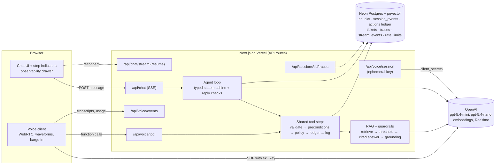
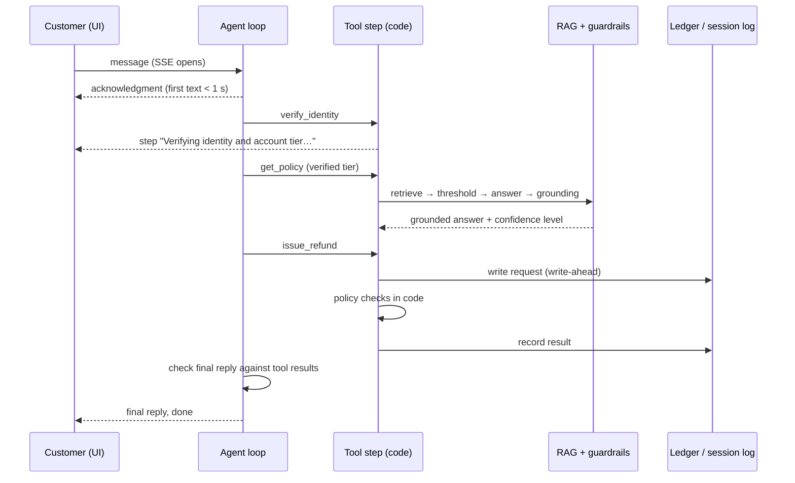
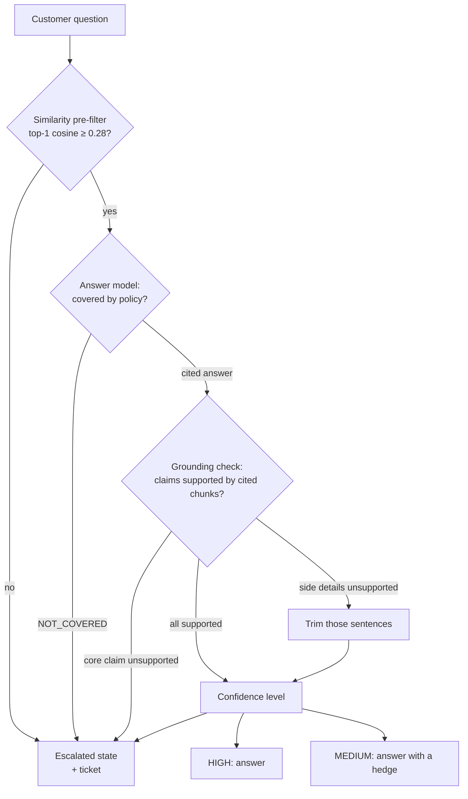

# Fernway Support: customer support AI agent (chat + live voice)

A full-stack support agent for a fictional SaaS, **Fernway Workspace**. It answers from a policy knowledge base behind measured guardrails, verifies customers, issues refunds within policy, and escalates to humans, over **streaming chat** and **live voice** that share one session.

> **Core idea: the model proposes, code decides.** The model chooses tools and writes replies; refund limits, identity checks and escalation rules are enforced in code, and every reply is checked against what the tools actually returned.

| | |
|---|---|
| **Live demo** | https://customer-support-agent-sable-two.vercel.app (voice debugging: `/voice-debug`) |
| **Demo account** | `omar@example.com`, PIN `715204` (Pro tier). All demo accounts are listed on the page; they are fictional, and PINs are shown on purpose |
| **Loom walkthrough** | _link added after recording_ |
| **Stack** | Next.js (App Router, TypeScript) on Vercel · Neon Postgres + pgvector · OpenAI (`gpt-5.4-mini` agent, `gpt-5.4-nano` checks, embeddings, Realtime voice) |
| **Tests** | 200 tests (unit, scripted-model scenarios, architecture), CI on every push |

---

## How this meets the brief

| Brief requirement | What's built | Where to see it |
|---|---|---|
| **Streaming chat** with step status | SSE with typed, numbered events; live steps such as "Verifying identity and account tier…", "Searching knowledge base…"; first text in under a second | Chat UI · `app/api/chat` |
| **Live voice** with waveform, transcripts, interruption | OpenAI Realtime over WebRTC; waveforms for both sides; live transcripts; barge-in that stops playback and truncates to what was heard; listening / thinking / speaking indicator | Voice toggle · `components/voice` |
| **Observability drawer** | Per-turn span tree, redacted prompts, latency (time to first token, end-to-end, per tool, p50/p95), tokens, **estimated** cost (voice included) | Drawer · `lib/observability` |
| **Vector retrieval + custom chunking** | pgvector on Neon; section-aware chunking with tier metadata; tier filter in SQL | [Chunking choices](#chunking-choices) |
| **Confidence guardrails → human escalation** | Similarity pre-filter, an abstaining answer model, a grounding check, and a 3-level confidence score; low confidence ends the turn in an `escalated` state with a ticket | [Guardrails and confidence](#guardrails-and-confidence) |
| **Reasoning loop with ≥3 chained tools** | Typed state machine; `verify_identity` → `get_policy` (tier-filtered) → `issue_refund` / `create_escalation_ticket` | [Tools and policy](#tools-and-policy-enforced-in-code) |
| **Live tool status in the UI** | `step_started` / `step_completed` events in chat; the same steps, plus a spoken "Let me check that…", in voice | Chat and voice UIs |
| **Error recovery** | Retries with backoff, typed fallbacks per failure, a 40 s turn deadline, stream resume, and a failure-simulation control | [Resilience](#resilience-observability-and-security) |
| **Session state across text and voice** | One append-only session log shared by both modes: verify in chat, continue by voice, or the reverse | `lib/session` |
| **Deliverables** | Repo with `.env.example` · this README · live demo · Loom | above |

---

## Architecture



**Key design points**
- **One tool step for chat and voice.** Voice function calls go to `/api/voice/tool`, which runs the *same* validation, preconditions, policy and ledger code as chat. No tool logic runs in the browser.
- **One session log for both modes.** Messages, tool calls and results are appended to one ordered log; each turn rebuilds its context from it.
- **Keys stay on the server.** The browser only ever receives a 60-second ephemeral voice key.
- **Layers are enforced** by `tests/architecture.test.ts` and an ESLint rule: UI → API routes → `lib/server` → orchestration (`agent`, `voice`) → `tools` → `guardrails` → `rag` → infra (`db`, `session`, `observability`). Imports only go downward.

### How one chat turn works



- At most 6 tool steps per turn (then a final reply is forced), one tool call per step.
- Every turn has a **40 s deadline**, passed to every OpenAI call (8 s per call inside tools; our retry layer is the only one).

### Module map

| Module | Responsibility |
|---|---|
| `lib/contracts.ts` | Shared contracts: tool names, `ToolOutcome` (discriminated union per tool), API payloads |
| `lib/agent` | Turn loop, typed state machine, model adapter, retries, system prompt |
| `lib/tools` | Tool registry (zod schemas, preconditions, typed errors), **policy as pure code** (`policy.ts`), the shared tool step (`step.ts`), stores |
| `lib/rag` | Chunker, idempotent ingest, embeddings, tier-filtered retrieval, injection scanner, cited answers |
| `lib/guardrails` | Confidence gate, citation and grounding checks, final-reply and action-claim checks |
| `lib/voice` | Realtime session config, ephemeral keys, voice tool bridge, transcript and usage recording |
| `lib/session` | Append-only session log, stream log for resume, per-browser ownership |
| `lib/observability` | Traces, redaction, cost estimates, drawer report |
| `lib/server` | Production wiring (Postgres stores, OpenAI clients) |
| `app/`, `components/` | Pages, API routes, chat, SSE client, voice (`useVoice` hook + transport, audio, events, tool bridge, interruption, transcript), drawer |

---

## Chunking choices

- **Corpus:** 11 support documents in `data/policies/`: tiers, refunds, contract status, account changes, billing disputes, three troubleshooting guides, escalation, privacy, and one deliberately poisoned FAQ.
- **Section-aware chunks** (`lib/rag/chunker.ts`):
  - One chunk per `##` / `###` section, so a tier's limit, window and conditions stay together.
  - 350-token cap with 40-token overlap, used only when a section must be split.
  - Each chunk's embedded text is prefixed with `title > section`, so short sections keep their topic.
- **Tier metadata:** tier scope comes from each document's front matter, narrowed per section with `<!-- tiers: pro, enterprise -->`. The tier filter runs **in SQL** (pgvector HNSW with iterative scan).
- **Result:** 52 chunks, median 66 tokens.
- **Rejected:** fixed-size windows, because they split a rule from its conditions and mix tiers in one chunk.
- **Ingest** is idempotent (hash of content, chunking settings, embedding model and injection detector).
- **Prompt injection:** instruction-like text is **quarantined at ingest** (stored, never retrieved). It's one layer among several: data-only prompt framing, the claim checks, and policy in tool code.

---

## Guardrails and confidence



**What each layer actually does** (current code, 2026-11-24; exact 95% Clopper–Pearson intervals; recompute with `npm run eval:evidence`):
- **Similarity pre-filter (0.28).** A cheap screen before any LLM call, **not a calibrated boundary**: the full guardrail's results are flat from 0.10 to 0.44 on the calibration split, and 0.28 is the midpoint of that range. It caught the 8 clearly out-of-domain blind items.
- **Answer model abstaining (`NOT_COVERED`).** This is what catches near-misses: **all 8 blind near-miss questions** were caught here. Across all 20 blind should-escalate items: abstention 11, pre-filter 8, grounding gate 1.
- **Grounding check.** Citations must exist in the retrieved set; `gpt-5.4-nano` checks each claim against the cited chunks. Unsupported side details are trimmed instead of escalating the whole answer. Its value on real drafts isn't measured separately yet (it caught 1 blind item).
- **Confidence shown to customers: HIGH / MEDIUM / LOW**, not raw similarity (raw scores stay in the drawer).
  - **HIGH:** grounded, nothing trimmed, top-1 ≥ 0.45, and the best document beats the second-best by ≥ 0.10 (thresholds chosen on the calibration split only).
  - **MEDIUM:** grounded but weaker or ambiguous retrieval, or partly grounded → answered with a hedge.
  - **LOW:** escalated. Verified customers get a P3 ticket opened in code; unverified customers are offered one; the turn ends `escalated` with the guardrail's real reason on the card.
- **Before verification:** if a question needs tier-specific sections, the agent asks for email and PIN instead of escalating.

**Blind results** (v1 held-out 10 + v2 30, each run once):

| Items | False escalations | Missed escalations |
|---|---|---|
| All 40 | 2/20 (10%, CI 1–32%) | **0/20** (0%, CI 0–17%) |
| Hard: near-miss, tier-specific, approval demands, injections (23) | 2/11 (18%, CI 2–52%) | 0/12 (0%, CI 0–26%) |
| Ordinary in-scope (9) | 0/9 (0%, CI 0–34%) | — |
| Out-of-domain (8) | — | 0/8 (0%, CI 0–37%) |

**Harder set** (18 items written and committed *before* running; `evals/HARDER_SET.md`):
- False escalations **1/9** (CI 0–48%).
- Missed escalations **3/9** (CI 7–70%): two approval demands answered with accurate policy text, and one partly covered question answered with an explicit "the documents don't say". In the agent, a refund request goes to `issue_refund`, which decides in code, so an approval demand answered by the policy lookup can't move money.

**Labelling:** one rule for every set (`evals/LABELING.md`): a query that only demands an approval ("approve my $900 refund") should escalate. This rule was adopted after the first results were seen; `evals/RESULTS.md` reports results under both the original and the current rule. Under the original labels the blind 40 give false escalations 3/21 (CI 3–36%) and missed escalations 0/19 (CI 0–18%).

**Confidence level vs answer correctness** (`evals/CONFIDENCE.md`; answers labelled against the cited documents by the coding assistant, see limitations):

| Level | Blind 40 | Harder 18 | Pooled |
|---|---|---|---|
| HIGH answered correctly | 14/14 | 6/7 | **20/21** (CI 76–100%) |
| MEDIUM answered correctly | 5/6 | 2/4 | 7/10 (CI 35–93%) |
| LOW: escalation was right | 19/20 | 6/7 | 25/27 (CI 76–99%) |

HIGH's point estimate is higher than MEDIUM's (95% vs 70%), but the intervals overlap, so **it isn't shown that HIGH is more accurate than MEDIUM** at these sample sizes.

---

## Tools and policy (enforced in code)

| Tool | Rules |
|---|---|
| `verify_identity(email, PIN)` | Same error whether or not the email exists · locks after 3 failures in a conversation (opens a P1 security ticket) · 5 per account + IP per 15 min, 20 per account per hour · returns only tier, contract status and invoices (no name, email or PIN) |
| `get_policy(question)` | The guarded RAG pipeline, filtered to the **verified** customer's tier (general sections only before verification) |
| `issue_refund(invoice, amount, reason)` | See the checks below |
| `create_escalation_ticket(reason, summary)` | Priority from the escalation policy · response target from the tier · idempotent per session and topic, so retries dedupe but different problems get separate tickets |

**`issue_refund` checks, in order:**
- **Identity verified**, then **the customer asked for a refund** (chat), and **for this invoice**: named by id, by a uniquely matching amount, or by description; otherwise `INVOICE_MISMATCH`. If none was named and several are eligible, `INVOICE_AMBIGUOUS` makes the agent ask which one.
- Then: contract active (an expired contract or suspended account opens the required billing ticket in code) → own invoice → no chargeback → not already refunded → amount in whole cents, ≤ the invoice → within the window → within the tier limit, all using the **current** account record.
- **Tier limits:** Free $20 / 7 days · Pro $200 / 30 days · Enterprise $1,000 / 60 days.
- **Write-ahead, idempotent ledger:** the request is recorded before any success is acknowledged; retrying the same request returns the same result.
- **Concurrency:** a unique index allows one active refund per invoice, even for simultaneous requests.
- **Crash recovery:** a pending entry expires after 2 minutes, so a crash can't lock an invoice forever.

**Checks on what the customer reads:**
- **Final reply grounding:** the final reply's factual claims are checked against the tool results from this conversation.
  - **No tool ran and a claim is unsupported** (off-topic, invented facts): code runs the guardrail itself, so "recommend a stock" reaches the escalated state whatever the model chose to do.
  - **After a policy lookup:** unsupported sentences are removed.
  - **Turns with only action tools, and short confirmations:** the finding is logged, not enforced.
- **Action-claim check:** a claimed refund, ticket or amount that the tools didn't produce is replaced with what actually happened (20/20 on a labelled set; `evals/ACTION_CLAIMS.md`).
- **In voice,** audio already spoken can't be rewritten, so these checks flag the mismatch in the transcript and trace instead.

---

## Resilience, observability and security

**Failure handling**
- Retries with exponential backoff and jitter, honouring `Retry-After`; never retried after text has streamed; tools are never retried automatically.
- A typed error and its own UI state per failure: timeout, rate limit (429), tool failure, knowledge base down, rate-limited by us.
- **Failure simulation control** in the drawer injects real faults at the SDK boundary (a real timeout, a genuine 429, a refund failure after recording, unreachable embeddings, a stream drop). Results: `evals/RESILIENCE_CHECKS.md`.
- A dropped chat stream resumes from the last event number, with no duplicated or missing text.

**Observability drawer** (per session)
- Span tree with start/end times; errors shown as error spans with their codes.
- Redacted prompts, tool inputs and outputs, guardrail decisions with confidence, claim-check corrections.
- Latency: time to first token, end-to-end, per tool, session p50/p95.
- Tokens (cached included) and **estimated** cost from a dated pricing table, voice included; copy-JSON.

| 3-tool chat turn | Voice turn and session summary |
|---|---|
|  |  |

**Security and cost controls**
- Sessions are bound to the creating browser (HttpOnly owner cookie).
- Per-IP and daily rate limits on chat, voice sessions, voice tools and retrieval (Postgres-backed).
- PINs redacted before anything is stored; voice transcripts from the browser are stored as client-reported.
- Ephemeral voice keys only; CSP and security headers; typed error bodies with request ids; structured logs; React error boundaries.
- `/api/health` checks the database, embeddings and LLM without spending tokens.

---

## Key trade-offs

| Choice | Why | Cost |
|---|---|---|
| One Next.js app; API routes as the backend | One deploy, shared types, no CORS | No long-lived server, so chat uses SSE rather than WebSockets |
| Custom typed state machine, not LangGraph | Every state and transition explicit and tested | Less built-in tooling |
| Neon Postgres + pgvector for everything | One store; tier filter and joins in SQL | Not a dedicated vector DB |
| `gpt-5.4-mini` for the agent | 35/35 live scenario runs (commit c585c0d; later commits changed only step-row text and docs); `gpt-5.4-nano` (about 3× cheaper) took unrequested actions | ~$0.002–0.005 per turn |
| `gpt-realtime-2.1-mini` for voice | About 3× cheaper audio than `gpt-realtime-2.1`; fine for short answers | Slightly less natural speech |
| Semantic turn detection in voice | Waits for callers to finish (e.g. while reading a PIN) instead of cutting them off | Interruption detection ~0.5–0.8 s after the caller starts speaking (measured 0.54–0.79 s across live checks) |
| Held, checked final replies | False action claims are corrected before release; ungrounded facts are caught in no-tool and policy turns (logged only in action-tool turns) | The final reply arrives as a block after checks (~1–2 s); a claim-free acknowledgment keeps first text under 1 s |
| One tool call per step | Deterministic ordering, simpler policy checks | More round trips (3-tool turn ≈ 5–7 s total) |
| Browser-enforced 3-minute voice cap | The browser connects to OpenAI directly, so the server can't hang up the call | Backed by 60 s keys, per-IP/daily caps and output-token limits; see limitations |
| Sessions bound to a browser cookie, no accounts | Prevents reading or acting on someone else's session | Clearing cookies loses access to old conversations |

---

## What the evidence does and doesn't show

**Shows** (current code, 2026-11-24):
- No missed escalation on 20 blind should-escalate items (0/20, CI 0–17%).
- The answer model abstaining is what catches near-misses.
- Policy rules hold in code: limits, windows, contract status, invoice ownership and matching, refund only on request. Each is unit-tested and was refused live.
- 7 live chat scenarios on frozen code (commit c585c0d): **35/35 runs** (CI 90–100%), pass^5 for 7/7 scenarios (CI 59–100%).

**Doesn't show:**
- **Tight error rates:** n is 9–40 per table, so intervals are wide.
- **The grounding checker's value on real drafts:** it caught 1 blind item.
- **That HIGH is more accurate than MEDIUM:** the intervals overlap.
- **Robustness on harder items:** 3/9 missed escalations on the harder set.
- **Independent labels:** answer correctness was labelled by the coding assistant against the cited documents, not by an independent human.

---

## What breaks first at 100× traffic

| What breaks | Why | Cheapest mitigation |
|---|---|---|
| Global daily caps | Each is one hot Postgres row; a few IPs can exhaust the demo for everyone | Shard the counter or move it to Redis/Upstash; per-IP limits first |
| OpenAI rate limits | One key, so 429 storms; retries amplify them | A token bucket per model, a queue with backpressure, an early "busy" reply |
| Neon load | Stream-resume polling, the session log re-read per agent step, sequential queries per turn | Keep the log in memory during a turn; push resume events instead of polling; batch trace writes |
| Voice cost | The 3-minute cap is enforced in the browser | Move the SDP exchange to the server and hang up at the cap |

---

## Known limitations

- **Voice limits aren't server-enforced.** The browser does the SDP exchange with an ephemeral key, so the server never learns the call id and can't end the call. A modified client could change session settings, stay past 3 minutes or under-report usage. Held server-side: 60 s keys, 6 voice sessions per IP per 10 min and 60 per day, output-token caps at minting, every tool call through `/api/voice/tool` with policy in code, rate-limited transcript and usage posts. Fix: move the SDP exchange to the server (DECISIONS D55).
- **Voice checks** were run with synthetic speech played into the microphone track; the network-drop test was simulated.
- **"Ask which invoice"** applies in chat only; in voice, transcripts can arrive after the tool call, so voice only checks mismatches against transcripts logged so far.
- **Interrupted answers:** when the server doesn't confirm truncation, the heard portion is estimated (~15 characters per second).
- **Shared demo data:** with no user accounts, refunds one reviewer issues affect the next (extra invoices per user mitigate this).
- **Final-reply grounding uses a model:** to bound false positives, tool turns and short confirmations are only logged; only other no-tool turns can trigger the guardrail.
- **Small evaluation sets:** they show behaviour, not tight error bounds.

---

## Next steps
- **Code-rendered receipts:** refund and ticket confirmations rendered from tool results by code, so the model never states actions and the claim checks become a backstop.
- **Independent labels:** a human-labelled held-out set of 100+ with a second labeller.
- **Approval demands routed to the refund tool in code,** not via the policy lookup.
- **Server-side voice control** (sideband connection and hangup) and server-side transcripts.

---

## Run it

```bash
cp .env.example .env.local        # DATABASE_URL (Neon, pooled), OPENAI_API_KEY; optional ADMIN_KEY
npm install
npm run db:migrate                # applies db/migrations/*.sql once each
npm run ingest                    # chunk + embed data/policies (idempotent)
npm run dev                       # http://localhost:3000
```

| Command | What it does |
|---|---|
| `npm test` | Unit + scenario tests (scripted model); live DB tests skipped without env |
| `npm run typecheck`, `npm run lint` | Type and lint checks |
| `npm run eval:guardrails` | Threshold sweep and held-out scoring → `evals/RESULTS.md` (~$0.03) |
| `npm run eval:heldout` | Fresh held-out guardrail set, run once (~$0.02) |
| `npm run eval:grounding` | Grounding-checker sanity set |
| `npm run eval:action-claims` | Model vs regex action-claim check → `evals/ACTION_CLAIMS.md` |
| `npm run eval:agent -- gpt-5.4-mini [--repeat 5]` | Live multi-turn scenarios → `evals/AGENT_RESULTS.md` |
| `npm run eval:evidence` | Recomputes the evidence summary with intervals (both labelling rules) |
| `npm run eval:confidence [-- --set v3]` | Confidence-level validation / harder set → `evals/CONFIDENCE.md`, `evals/HARDER_SET.md` |
| `npm run demo:reset` | Clears demo refunds and tickets (developer machine only) |
| `GET /api/rag/search?q=…` | Retrieval inspector: public = general sections, no traces; with `x-admin-key`, tier filter and full trace |

## Evidence and design records
- `evals/`: `RESULTS.md` (guardrail sweep, held-out sets, intervals), `HARDER_SET.md`, `CONFIDENCE.md`, `LABELING.md`, `ACTION_CLAIMS.md`, `AGENT_RESULTS.md`, `VOICE_CHECKS.md`, `RESILIENCE_CHECKS.md`
- `docs/DECISIONS.md`: every design decision with its reason and the rejected alternative
- `docs/REVIEW.md`: independent review findings and how each was resolved
