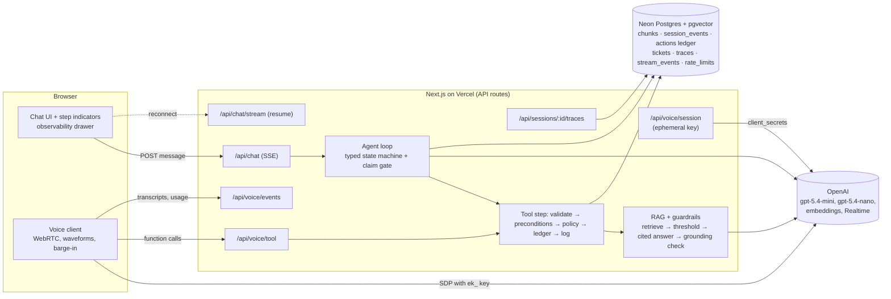

# Fernway Support: customer support AI agent (chat + live voice)

A full-stack customer support agent for a fictional SaaS ("Fernway Workspace"). It answers from a policy knowledge base with calibrated confidence guardrails, verifies customers, issues refunds within policy, and escalates to humans. It works over streaming chat and live voice, shares one session across both, and shows every step in an observability drawer.

- **Live demo:** https://customer-support-agent-sable-two.vercel.app (voice debugging and test clips: `/voice-debug`)
- **Demo accounts:** listed on the page (fictional; PINs shown on purpose). Example: `omar@example.com`, PIN `715204`, Pro tier.
- **Loom walkthrough:** _link added after recording_

## Architecture



**Module map**

| Module | Responsibility |
|---|---|
| `lib/agent` | Turn loop (`run.ts`), typed state machine (`machine.ts`), model port + OpenAI adapter, retries (`retry.ts`), claim gate (`claims.ts`), shared tool step (`tool-step.ts`), system prompt |
| `lib/tools` | Tool registry (zod schemas, preconditions, typed errors), **policy as pure code** (`policy.ts`), tools, stores behind ports (Postgres + in-memory), mock CRM |
| `lib/rag` | Section-aware chunker, idempotent ingest, embeddings, tier-filtered pgvector retrieval, cited answer generation |
| `lib/guardrails` | Retrieval-confidence gate, citation check, LLM claim check, injection scanner, data-only prompt framing, the guarded pipeline |
| `lib/voice` | Realtime session config + ephemeral key minting, voice tool bridge, transcript and usage recording |
| `lib/session` | Append-only session event log (shared by chat and voice), stream log for resume, per-browser session ownership |
| `lib/observability` | Traces (spans with parents, tokens, cost), redaction, persistence, the drawer report (p50/p95) |
| `app/`, `components/` | Next.js pages and API routes; chat, voice bar, waveforms, trace drawer |

## How a turn works

**Chat** (`POST /api/chat` → SSE). The agent rebuilds context from the session log. The model (`gpt-5.4-mini`, one tool call per step, at most 6 steps) chooses a tool, and **code** runs it:
1. Validate the input with zod.
2. Check preconditions (identity before any account action).
3. Apply the policy rules.
4. Write the action to the ledger.
5. Log the call and its result.

Each step streams `step_started` / `step_completed` events ("Verifying identity and account tier…", "Searching knowledge base…"). The reply streams **sentence by sentence through a claim gate**: any sentence claiming a refund, ticket, amount or ticket id that the session's tool results don't show is replaced with the truth. Events are numbered; a dropped stream resumes from the last number.

**Voice** (OpenAI Realtime over WebRTC). The server mints a 60-second ephemeral key with the instructions, tools and verified-account context; the browser connects directly.
- **Tool calls** go to `/api/voice/tool`, which runs the **same tool step as chat**.
- **Barge-in:** semantic VAD detects speech. The client mutes playback at once, clears the server audio buffer and truncates the item to what was heard. The transcript is marked "interrupted".
- **Shared session:** voice transcripts land in the same session log, so you can verify in chat and continue by voice, or the other way round.

## RAG and chunking

- **Corpus:** 11 support documents in `data/policies/`: tiers, refunds, contract status, account changes, billing disputes, three troubleshooting guides, escalation, privacy, and one deliberately poisoned FAQ.
- **Section-aware chunking** (`lib/rag/chunker.ts`):
  - One chunk per `##`/`###` section, so a tier's limit, window and conditions stay together.
  - 350-token cap with 40-token overlap, used only when a section is split.
  - Each chunk is labelled with its heading path. The embedded text is prefixed with `title > section`, so short sections keep their topic.
  - Tier scope comes from the front matter, narrowed per section by `<!-- tiers: pro, enterprise -->`. The tier filter runs **in SQL** (pgvector HNSW with iterative scan).
  - Result: 52 chunks, median 66 tokens. Fixed-size windows were rejected because they split a rule from its conditions and mix tiers in one chunk.
- **Ingest** is idempotent (a per-document hash of content, chunking settings, embedding model and injection detector). Instruction-like text is **quarantined at ingest**: stored, but excluded from retrieval. It is one layer among several; the others are data-only prompt framing, a claim checker that rejects instruction-based claims, and policy in tool code.

## Confidence guardrails (measured, not guessed)

1. **Retrieval gate:** top-1 cosine ≥ **0.28**.
   - Chosen on a 20-query calibration split of a 30-query labelled set. The rule: zero missed escalations for the full guardrail, then fewest false escalations, then the midpoint of the tied range.
   - The held-out split (10 queries) was scored once: **1/6 false escalations, 0/4 missed**.
   - Similarity alone can't separate near-miss questions from answerable ones (it needs t ≥ 0.58, which escalates 67% of answerable queries). So the threshold screens clear out-of-scope queries before any LLM call, and gate 2 catches near-misses. See `evals/RESULTS.md`.
2. **Grounding gate:** the answer must cite retrieved chunk ids. Every cited id must exist in the retrieved set. A second model (`gpt-5.4-nano`, chosen by a hand-labelled sanity set: 9/9) checks each claim against the cited chunks. A missing or invalid citation, an unsupported claim, or a "not covered" answer → **escalation state** (typed decision with reason, confidence and evidence; the UI shows an escalation card).

## Tools and policy (enforced in code)

| Tool | Rules |
|---|---|
| `verify_identity(email, 6-digit PIN)` | Strict formats (placeholders don't count as attempts). Same error whether or not the email exists. Lock after 3 failures in a conversation (opens a P1 security ticket) **and** after 5 per account across sessions. Returns tier, contract status and invoices only (no name, email or PIN). |
| `get_policy(question)` | The guarded RAG pipeline above, filtered to the **verified** customer's tier (general sections only before verification). |
| `issue_refund(invoice, amount, reason)` | Identity → contract active (an expired contract or suspended account opens the required billing ticket in code) → own invoice → no chargeback → not already refunded → whole cents → ≤ invoice → within window → ≤ tier limit (Free $20/7 d, Pro $200/30 d, Enterprise $1,000/60 d). **Write-ahead, idempotent ledger:** recorded before any success is acknowledged. A unique index allows one active refund per invoice, even under concurrency. |
| `create_escalation_ticket(reason, summary)` | Priority from the escalation policy, response target from the tier, idempotent per session and reason. |

## Resilience, observability, production

- **Failure handling:**
  - LLM calls retry with exponential backoff + jitter, honouring Retry-After. They are never retried after text has streamed.
  - Each failure type has a typed error and its own UI state: timeout, 429, tool failure, knowledge base down, rate limited.
  - A failure simulation control in the drawer injects real faults (a real SDK timeout, a genuine HTTP 429, refund failure after recording, unreachable embeddings, a stream drop). Results are in `evals/RESILIENCE_CHECKS.md`.
- **Observability drawer** (per session):
  - Span tree with start/end, redacted prompts, tool inputs and outputs, guardrail decisions and claim-check corrections.
  - TTFT, end-to-end and per-tool latency, session p50/p95.
  - Tokens (cached included), and **estimated** cost from a dated pricing table, voice included. Copy-JSON.
- **Security:**
  - Sessions are bound to the creating browser (HttpOnly owner cookie).
  - Per-IP and daily rate limits in Postgres.
  - PINs redacted before anything is stored.
  - Ephemeral voice keys only; CSP and security headers.
  - Typed error bodies with request ids, structured logs, React error boundaries.
  - `/api/health` checks the DB, embeddings and the LLM.

## Key trade-offs

| Choice | Why | Cost |
|---|---|---|
| One Next.js app on Vercel; API routes are the backend | One deploy, shared types, no CORS | No long-lived server (WebSockets), so chat uses SSE |
| Custom typed state machine instead of LangGraph | Every state and transition explicit and tested | Less built-in tooling |
| Neon Postgres + pgvector for everything | One store; tier filter and joins in SQL | Not a dedicated vector DB |
| `gpt-5.4-mini` for the agent | Passed 6/6 live scenarios. `gpt-5.4-nano` is about 3× cheaper but took unrequested actions | Higher cost per turn (~$0.002–0.005) |
| `gpt-realtime-2.1-mini` for voice | 3.2× cheaper audio than `gpt-realtime-2.1`; fine for short answers | Slightly less natural speech |
| Similarity threshold 0.28 + grounding gate | Measured on a split eval set; similarity alone can't separate near-misses | An extra LLM call per policy answer (~1 s) |
| Sentence-gated streaming (claim gate) | False action claims never reach the user | First text appears per sentence, after tool steps |
| One tool call per step | Deterministic ordering and simpler policy checks | More round trips (3-tool turn ≈ 5–7 s) |
| Voice claims can't be rewritten | Audio is already spoken | Mismatches are flagged in the transcript and trace instead |
| 3-minute voice cap (client) + server `max_output_tokens` + key TTL + per-IP/daily caps | Bounds cost on a public demo; the Realtime API has no session-duration setting | A long call must be restarted |

## Run it

```bash
cp .env.example .env.local        # DATABASE_URL (Neon, pooled) and OPENAI_API_KEY
npm install
npm run db:migrate                # applies db/migrations/*.sql once each
npm run ingest                    # chunk + embed data/policies (idempotent)
npm run dev                       # http://localhost:3000
```

| Command | What it does |
|---|---|
| `npm test` | Unit + scenario tests (scripted model); live DB tests are skipped without env |
| `npm run typecheck`, `npm run lint` | Type and lint checks |
| `npm run eval:guardrails` | Threshold sweep and held-out scoring → `evals/RESULTS.md` (~$0.03) |
| `npm run eval:grounding` | Grounding-checker sanity set → `evals/RESULTS.md` |
| `npm run eval:agent -- gpt-5.4-mini` | Live multi-turn scenarios → `evals/AGENT_RESULTS.md` (~$0.03) |
| `npm run demo:reset` | Clears demo refunds and tickets (developer machine only; asks to confirm) |
| `npm run voice:clips` | Regenerates the synthetic caller clips for `/voice-debug` |

## Evidence

- `evals/RESULTS.md`: guardrail calibration and the grounding-checker sanity check
- `evals/AGENT_RESULTS.md`: live agent scenarios
- `evals/VOICE_CHECKS.md`: voice checks on the live URL
- `evals/RESILIENCE_CHECKS.md`: failure injection checks
- `docs/REVIEW.md`: independent review findings and fixes
- `docs/DECISIONS.md`: every design decision with reasons and the rejected alternative

## Known limitations

- **Voice tests used synthetic speech.** Voice checks were run with synthetic TTS speech played into the mic track, not a person on a microphone. The network-drop test was simulated.
- **Approximate heard text.** When the server doesn't confirm truncation, the heard portion of an interrupted answer is estimated (about 15 characters per second).
- **No user accounts.** Ownership is per browser cookie; demo data is shared, so refunds one reviewer issues affect the next (extra invoices per user mitigate this).
- **Structure follow-ups:** the voice hook is large and not yet split into transport, events and tool bridge. Tool results are typed `unknown` at the registry boundary (casts downstream). A few modules import across layers (chat uses wiring from `lib/voice/deps.ts`; `rag` and `guardrails` reference each other).
- **Untested by unit tests:** the guardrail pipeline's branch logic (covered by the paid evals) and the stream-resume protocol (verified live).
- **Restored transcripts** lose step indicators after a reload (the drawer keeps the full trace).
